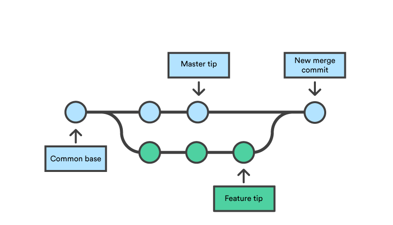

# Intro

## Overview

Today is about **tools** and **workflows**, not research process.

We want to

- To share some of the tools we use to make us more productive

- Help you figure out the right tool for the job

- Make it easier for you to use these tools

*We are economists, not software engineers or computer scientists!*

## Course materials

Course materials are a public good.

*Pull requests* on Github are welcome and will enhance the public good!

<https://github.com/magerton/research-computing-bootcamp/>

# Reproducability

## 3 kinds of reproducibility

1. **Methods:** *The ability to implement, as exactly as possible, the experimental and computational procedures, with the same data and tools, to obtain the same results.*

2. Results: *obtaining the same results from the conduct of an independent study*

3. Inferential: *do we interpret results from an independent or reanalysis study in same way?*

[@goodman2016what]

## Reproducible research

Make the *entire research process* transparent

Not just regression tables. It includes

- Every step of data-work (including downloading!)
- Your figures
- Sources for any fact you cite

Reproducible research is about **workflow** and **sharing**

## Why bother with reproducible research?

1. We are scientists who (ostensibly) care about the truth, and need others to be able to verify it (altruistic).

2. We can build off one another's work (spillovers).

2. Journals care about it (*not* altruistic).

3. It'll make your life easier (in the long run) (also not altruistic).


## New AER Reproducibility Guidelines (Methods)

- AER's [Data and Code Availability Policy](https://www.aeaweb.org/journals/policies/data-code)

    *It is the policy of the American Economic Association to publish papers only if the data and code used in the analysis are clearly and precisely documented, and access to the data and code is clearly and precisely documented and is non-exclusive to the authors.*

- If you have proprietary data, tell the editor this in your cover letter!

## More on AER guidelines

- *For econometric, simulation, and experimental papers, the replication materials shall include*

    a. the data set(s), 

    b. the programs used to create any final and analysis data sets from raw data, 

    c. programs used to run the final models, and 

    d. description sufficient to allow all programs to be run.

- Social Science Data Editors [Verification guidance](https://social-science-data-editors.github.io/guidance/Verification_guidance.html) and [Replication Template](https://github.com/AEADataEditor/replication-template/blob/master/REPLICATION.md)

<!-- - "Top 10 list of papers on reproducible research" [@barba2017barbagroup] -->

## Ten Simple Rules for Reproducible Computational Research

<!-- 1. For Every Result, Keep Track of How It Was Produced
2. Avoid Manual Data Manipulation Steps
3. Archive the Exact Versions of All External Programs Used
4. Version Control All Custom Scripts
5. Record All Intermediate Results, When Possible in Standardized Formats
6. For Analyses That Include Randomness, Note Underlying Random Seeds
7. Always Store Raw Data behind Plots
8. Generate Hierarchical Analysis Output, Allowing Layers of Increasing Detail to Be Inspected
9. Connect Textual Statements to Underlying Results
10. Provide Public Access to Scripts, Runs, and Results

Taken from @sandve2013ten

::: notes -->

See @sandve2013ten

1. For Every Result, Keep Track of How It Was Produced
    + Notion of "workflow"... from raw data to final table
2. Avoid Manual Data Manipulation Steps
    + Excel is evil
3. Archive the Exact Versions of All External Programs Used
    + Python `virtualenv`, R's ~~packrat~~ `renv`, Julia's `[Project/Manifest].toml`, Stata `require.ado` all help here
    + Also hardware
4. Version Control All Custom Scripts
    + Git!!!
5. Record All Intermediate Results, When Possible in Standardized Formats
    + Show my example from SLURM

## Ten simple rules, continued

6. For Analyses That Include Randomness, Note Underlying Random Seeds
7. Always Store Raw Data behind Plots
    + Generate plots & tables programatically
8. Generate Hierarchical Analysis Output, Allowing Layers of Increasing Detail to Be Inspected
9. Connect Textual Statements to Underlying Results
    + For each statement, where did it come from? Cite the source or note your data
10. Provide Public Access to Scripts, Runs, and Results
    + Github, AER data site, Harvard Dataverse, etc


## How to do this?

- Gold Standard? 

    + Create entire paper with one command. (Jay will talk about `Make`, which I have started using)

    + *Literate programming*: Rmarkdown, Jupyter notebooks, Stata's `dyndoc`

- At minimum, list of scripts you can run in order

# Nuts and bolts of my projects

## Mark's strategy

1. Document everything (bad about this, getting better with Github issues)

2. Version control (almost) everything

3. Automate as much as practical

## Benefits & costs

- On the plus side

    + Keeps me organized
    + Means others can understand what I'm doing
    + Lowers marginal cost of re-running analysis with new data, assumptions, etc
    + Reduces errors

- But
    + Higher fixed costs
    + Co-authors grumpy about new software

## Starting a new project

- Everything lives in one folder

- IDE/Editor **project** file: Sublime, VS Code, Rstudio

- Track everything with Git

- And keep only 1 version (no redundancy!)

- Everything is a text file (except data and .pdfs)
    + "Diff"-able (track changes)
    + Future-proofed
    + Searchable from command line, Sublime Text

- Very large data - store on Box/Dropbox. 

## Folder structure and filenames {.allowframebreaks}

- `README.md` in every folder explains what's there
- Save `data-raw` 
    + Ideally download programatically
    + `README.md` documents acquisition (URL, date downloaded)
    + Save md5 hash of data (I forget to do this)
    + Don't ever modify it!
- `data-intermediate`
    + Processed data
- `writeup`
    + `paper/` has .tex files
    + `yyyy-mm-presentation/`
    + `figures/`
    + `tables/`
    + various notes
- `code`
    + `main.do`, `run_all.sh` or `MAKE` script to run all analysis
    + Name files in order of analysis `00a - download prices.R`, `00b - download shapefiles.R`. Number is stage of analysis (00: download, 01: ingest + subset, etc). Letter is order within this.  

## What to do with parameters?

- Sometimes we re-use parameters across many files
- What if we change them? Or have to hard-code?
- Create `R/CONSTANTS.R` file (no redundancy!) and `source("R/CONSTANTS.R")`

## R code for updating parameters

```
update_constants <- function(grepfor, replacewith, 
    file="R/CONSTANTS.R", update=TRUE) {
    orig_const <- readLines(file)
    orig_const[grep(grepfor, orig_const)] <- replacewith
    if (update) cat(orig_const, sep="\n", file="R/CONSTANTS.R")
    else return(orig_const)
}
```

in script where we compute `beta` that gets used elsewhere

```
paste0("beta <- ", sprintf("%a", beta), "  #  beta = ", beta) %>%
    update_constants("^beta", .)
```

## Can also create a `parameters.tex` file and use `SIunitx`

Write out parameters to `parameters.tex` as newcommand

- `\newcommand{\ChamberCount}{62}`

- In LaTeX, `\qty[round-mode=figures, round-precision=2]{\LeakContractActual}{\grams\per\second}` or `\ChamberCount{}`

- SIunitx can handle rounding

## Staying organized with lengthy jobs on a cluster

- Jobs on cluster get a unique job ID. See example SLURM script.

- Keep a `README.md` log with *metadata* (data about data) listing job IDs

- In the log, print 
    + unique "commit hash" to log that identifies current snapshot of the codebase
    + Lots of intermediate output
    + `sprintf` numbers in hexadecimal format so I can restart

```R
commit_hash <- system('git -C . rev-parse HEAD', intern = TRUE)
out <- paste0("\nRepo commit ", commit_hash, "\n\n")
cat(out, file=STAT_PTH, append=T)
```

```julia
thet optimal (binary)  = [-0x1.9f0f1d52eece2p+1, ]
thet optimal (decimal) = [-3.2426 ]
```

## Resources on project management / organization

- Software Carpentry [Data Management](https://v4.software-carpentry.org/data/mgmt.html) lesson

- Other economists' workflows
    + [Ryan Kellogg's Lab Wiki](https://github.com/kelloggrk/Kellogg_RA_Manual/wiki)
    + [Hunt Allcott's Lab Wiki](https://github.com/huntallcott/lab/wiki)
    + [Gentzkow and Shapiro *Lab Wiki*](https://github.com/gslab-econ/ra-manual/wiki)
    + [Gentzow and Shapiro *PDF Code and Data for the Social Sciences: A Practitioner's Guide*](https://web.stanford.edu/~gentzkow/research/CodeAndData.pdf)
    + [Knittel and Metaxoglou (2016) *Working with Data: Two Empiricists’ Experience*](https://doi.org/10.1515/jem-2016-0001)

# AI

## Generative AI in research

- I like Claude.ai

- Constant struggle: short vs long-run efficiency

- Who's in charge? 

- Great when I have done original/creative thinking and need help with routine things: cutting/processing/tables/graphs
- LLM product often inferior and smells like AI... or has errors
- Really important: use a "project" with instructions, or claude code with `CLAUDE.md` file
- Instructions need to be specific. "Before you start, do you have any questions?"

- Examples: ARE 155, flaring congestion

# Git

## What is Git?

- A program that keeps track of file histories

- The biggest-baddest "Undo" button ever --- roll back to any *commit*ted file

- Like Blockchain lite
    + Everyone gets the entire project history
    + Versions identified with cryptographic hash

- Searchable

- Can merge text file versions

## \#phdlife

\centering

<!-- { height=70% } -->
{ height=70% }

## Git

<!-- { height=60% } -->

{ height=60% }


## Git vs Dropbox

- Dropbox is better than nothing

    + Limits on how far back history saved
    + Can't choose what snapshots (*commits*) get saved
    + No metadata (*commit messages*) with saved versions
    + No tool to *merge* conflicting versions
    + Searching history is hard
    + Who changed what? (technical term: *blame*)

- But Git has higher fixed costs

- Git does NOT play well with Dropbox/Box/OneDrive/etc

## Git vs Github

<!--  -->


## Git resources

- Ivan Rudik's [lecture]https://github.com/AEM7130/class-repo/blob/master/lecture-notes/03-git/03-git.pdf)

- Grant McDermott's [lecture](https://raw.githack.com/uo-ec607/lectures/master/02-git/02-Git.html#1)

- QuantEcon [lecture](https://julia.quantecon.org/software_engineering/version_control.html)

## Repositories vs commits

- **Repository**: folder where the entire history is tracked (*repo*)

    + Can be on your computer (*local*)
    + Or hosted online (*remote*)
    + Puts a folder `.git` in your direcotry
    
- **Commit**
    + "snapshot" of your repository at a point in time. 3 pieces of info
        1. A unique ID (*SHA-1 hash*)
        2. Content: pointer to *parent commit* + *diff* (changes to it)
        3. Metadata: *commit message*, author, timestamp

- **Github**: online service hosts repos
    + Can have git without Github
    + Public vs private
    + Adds extra functionality, project management
    + Great [education discount](https://education.github.com/pack)


## What I'll show you today

- Git GUIs

    + **[Github Desktop](https://desktop.github.com/)** (what we do today)
    + [Git Kraken](https://www.gitkraken.com/)
    + [Sublime Merge](https://www.sublimemerge.com/)

- Can also use command line, esp. for complicated situations

## Workflow: Fork + Clone a repo

- Go to <https://github.com/magerton/research-computing-bootcamp.git>

- *Fork* the repo on the remote
    + Creates a *clone* of the repo in YOUR Github account
    + A *fork* keeps ability to sync original repo and yours

- *Clone* the repo from remote to local

    ```bash
    # (makes new folder)
    git clone https://github.com/[USERNAME]/research-computing-bootcamp.git
    ```

## Branches

- Branches are sets of commits

- Keep `main` branch with functioning code 

- Develop new features on *branches*

- When done, *merge* branches back to `main`

<!-- { height=50% } -->

{ height=50% }


## Workflow: Switching branches

```bash
## change working directory to new repo
cd my-first-test-repo

## add `-b` flag to create new branch
git checkout marks-test-branch
```

## Workflow: staging changes + adding commit

```bash
## make a new file
echo "do Actually Relevant Econ" > note-to-self.md

## see changes
git status
git diff

## stage changes
git add *.md     # markdown files
git add -u       # tracked files
git add --all    # all files

git commit -m "Note to self" -m "About how econ is great"

## PUSH changes to remote
git push
```

## Workflow: `checkout` branch and `merge` branches

```bash
## Switch back to master
git checkout main

## Merge in changes from `marks-test-branch` to current branch
git merge marks-test-branch
```

## Workflow: Create a repo {.allowframebreaks}

- Make a new *private* repo on Github (remote): [github.com/new](https://github.com/new)

- Create a *local* repo and then push changes to remote
    
```bash
## new directory
mkdir my-first-test-repo

## cd into it
cd my-first-test-repo

## create readme
echo "# my-first-test-repo" >> README.md

## tells git to track new repo
git init

## STAGES the file
git add README.md

## COMMITS staged changes
git commit -m "first commit"

## tell git where the REMOTE repo is
git remote add origin https://github.com/magerton/my-first-test-repo.git

## PUSH changes to UPSTREAM branch `main` on REMOTE `origin` 
git push --set-upstream origin main
```

## Authentication with Github Desktop & command line

- Github Desktop uses `https`-based authentication

- Command line works best with `ssh`

    + More from Arnon tomorrow

    + Github [Authentication help](https://help.github.com/en/categories/authenticating-to-github)
    + To switch from `https` to `ssh`
        * See Github help on [changing a remote's URL](https://help.github.com/en/articles/changing-a-remotes-url)

```bash
git remote -v
git remote set-url origin git@github.com:USERNAME/repository.git
```

## Syncing between computers

- `push` changes to the `remote`

- `pull` changes from `remote` to `local`
    
    + `pull` is equivalent to
     
        ```bash
        fetch
        git merge FETCH_HEAD
        ```


## `merge` conflicts

<!-- { height=40% } -->

{ height=40% }


- Resolve in text editor (Microsoft VS Code is great for this!)


## Important files

- `README.md` is for readers
    
    + Automagically displayed as HTML by Github

- `.gitignore` tells Git which files not to track

    + LaTeX temp files, big binary files, private keys
    + [.gitignore](../.gitignore) has an example

- `LICENSE.md` tells how others can use, cite, modify, etc your work

## What to do about binary files?

- Git is fantastic for tracking text files (.txt, .tex, .md, .R, .do, .py, .jl, .m)

- But not made for big binary files (.zip, .dta, .RData, .rda, .jld, .gz)

- Use `git-lfs` to handle binary files $\leq$ 2Gb
    
    + Store binary files on a separate server
    + Commits a text *pointer file* with unique *hash* and URL to repo
    + Way faster
    + 1 Gb for free, $5/mo for 50 Gb

```bash
git lfs track my-big-file.zip  # single file
git lfs track "*.zip"          # all files ending in .zip. note ""
```


## Project management on Github

- Permissions: who has the right to `push` to the repo?
    
    + repo > Settings > Collaborators

- Issue-tracking
    
    + Can reference issues in commit messages
    + Can tag other users

## Organizing data

- What I've started doing

    + Save raw data into `./data-raw/`, with README.md on how to get it

    + Ingest data *programatically* 
        * *Normalize* data as much as feasible. Redundancy is evil!
        * Save to `./data-intermediate/`

    + Further processing

        <!-- * Ideally, save to `./data-clean/` (I don't... { width=3% }) -->

- If data are huge, interesting guide on [Software Carpentry](https://v4.software-carpentry.org/data/index.html)

# Data management

## How I (try) to think about data

- Based on relational database theory

- Big idea is *normalization*
    + Redundancy is evil
    + Information should show up in one place only
    + Break out redundant parts into separate tables

- Why normalize?
    + Need less disk space
    + Lower chance of anomalies (misspellings, etc)

- Merge back together
    + Multiple tables painful in Stata
    + Easier with R (`dplyr` or my favorite, `data.table`)

## Normalizing data: Suppose you get this Excel spreadsheet

| LocID | Loc. nm.           | PlantID | Plant nm.       | Soil | Soil desc           |
| ----- | ------------------ | ------  | --------------- | ---- | -----------------   |
| 11    | Kirstenb. G.       | 431     | Leaucadendron   | A    | Sandstone           |
|       |                    | 446     | Protea          | B    | Sandstone/limestone |
|       |                    | 482     | Erica           | C    | Limestone           |
| 12    |Karbon. M.          | 431     | Leucadendron    | A    | Sandstone           |
|       |                    | 449     | Restio          | B    | Sandstone/limestone |

Example from [MariaDB.com](https://mariadb.com/kb/en/library/database-normalization-overview/)

## Trying to create a table....

| LocID  | Loc. nm.           | PlantID | Plant nm.       | Soil | Soil desc           |
| -----  | ------------------ | ------  | --------------- | ---- | -----------------   |
| 11     | Kirstenb. G.       | 431     | Leaucadendron   | A    | Sandstone           |
| `NULL` | `NULL`             | 446     | Protea          | B    | Sandstone/limestone |
| `NULL` | `NULL`             | 482     | Erica           | C    | Limestone           |
| 12     | Karbon. M.         | 431     | Leucadendron    | A    | Sandstone           |
| `NULL` | `NULL`             | 449     | Restio          | B    | Sandstone/limestone |

- Rows 1--3 from one group
- Rows 4--5 from another
- How do you reference a row?

## Each record needs to stand alone

| LocID | Loc. nm.           | PlantID | Plant nm.       | Soil | Soil desc           |
| ----- | ------------------ | ------  | --------------- | ---- | -----------------   |
| 11    | Kirstenb. G.       | 431     | Leaucadendron   | A    | Sandstone           |
| 11    | Kirstenb. G.       | 446     | Protea          | B    | Sandstone/limestone |
| 11    | Kirstenb.          | 482     | Erica           | C    | Limestone           |
| 12    | Karbon. M.         | 431     | Leucadendron    | A    | Sandstone           |
| 12    | Karbon. M.         | 449     | Restio          | B    | Sandstone/limestone |

- This is what our panels look like

- *Primary Key*
    + "specific choice of a minimal set of attributes (columns) that uniquely specify a tuple (row) in a relation (table)" [Wikipedia](https://en.wikipedia.org/wiki/Primary_key)
    + Here: `Loc.` AND `Plant` form a *composite* primary key
    + Could also be an ID number (row number?)

## Why is this not great?

| LocID | Loc. nm.           | PlantID | Plant nm.       | Soil | Soil desc           |
| ----- | ------------------ | ------  | --------------- | ---- | -----------------   |
| 11    | Kirstenb. G.       | 431     | Leaucadendron   | A    | Sandstone           |
| 11    | Kirstenb. G.       | 446     | Protea          | B    | Sandst/limestone    |
| 11    | Kirstenb.          | 482     | Erica           | C    | Limestone           |
| 12    | Karbon. M.         | 431     | Leucadendron    | A    | Sandstone           |
| 12    | Karb. M.           | 449     | Restio          | B    | Sandstone/limestone |

1. Table stores redundant information: *LocID* AND *Loc nm*
2. Misspellings!

## Removing the fields not dependent on the entire key {.allowframebreaks}

::: columns

:::: column

| LocID | PlantID |
| ----- | ------  |
| 11    | 431     |
| 11    | 446     |
| 11    | 482     |
| 12    | 431     |
| 12    | 449     |

| LocID | Loc. nm.           |
| ----- | ------------------ |
| 11    | Kirstenb. G.       |
| 12    | Karbon. M.         |

::::

:::: column

| PlantID | Plant nm.       | Soil |
| ------  | --------------- |------|
| 431     | Leaucadendron   | A    |
| 446     | Protea          | B    |
| 482     | Erica           | C    |
| 449     | Restio          | B    |

| Soil | Soil desc           |
| ---- | -----------------   |
| A    | Sandstone           |
| B    | Sandstone/limestone |
| C    | Limestone           |

::::

:::

- No redundancy. *Factor variables* in Stata, R or *Categorical Arrays* in Julia
- Join using *Foreign Key*: "a set of attributes that references a candidate key" [Wikpedia](https://en.wikipedia.org/wiki/Foreign_key)
- *Link table* `| LocID | PlantID |` to capture many-to-many relationship

## Dealing with data using R's `data.table`

I like R's `data.table` package if $<$ 2 billion rows

- Highly optimized
    
    + Much faster than `dplyr` if datasets are big (100k or more rows)

- In-place updating
    
    + `dplyr` and other packages copy dataframes if you modify them
    + Big deal if memory is an issue

- Parsimonious syntax
 
- Tight connection to SQL

- Joins
    
    + really fast
    + non-equi joins: `x.date <= y.date` or rolling joins (closest-to)

# Software

## What do I look for in software? {.allowframebreaks}

- Cross-platform

- Don't need the internet

- Everything is a text file $\implies$ need a good text editor
    + Syntax highlighting
    + Compile LaTeX & Markdown/Pandoc
    + Searchable with [Regular Expressions](https://en.wikipedia.org/wiki/Regular_expression)

- Minimize redundancy $\implies$ one text format to rule them all!
    + Markdown/Pandoc
        * Compile to Word, LaTeX, PPT, Beamer, Reveal.js, HTML
        * Auto-formatted on Github
        * Lighter syntax than LaTeX

- Git, Github Desktop
- [Zotero](https://www.zotero.org/download/) for bibliography (can share with people via [Groups](https://www.zotero.org/groups/))
- [Sublime Text 3](https://www.sublimetext.com/3) or [VS Code](https://code.visualstudio.com) for everything else

## Example

```R
update_or_add_to_file <- function(grepfor, replacewith, file="parameters.tex", update=TRUE) {
  original_constants <- readLines(file, warn = FALSE) # read file
  search_string <- paste0("\\newcommand{\\", grepfor, "}") # find command
  linenos <- grep(search_string, original_constants, fixed = TRUE) # search
  if (length(linenos) == 0) {
    cat(replacewith, file = file, append = TRUE, sep = "\n") # append if not found
  } else {
    original_constants[linenos] <- replacewith # replace
    writeLines(original_constants, file) # update file
  }  
  invisible(original_constants) # return orig const
}
```

# References

## References

